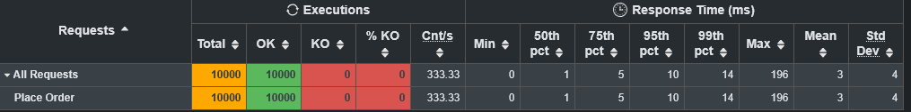
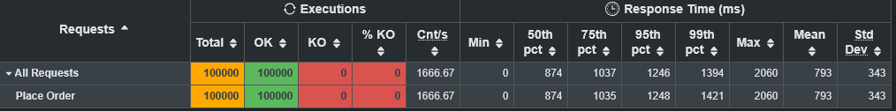
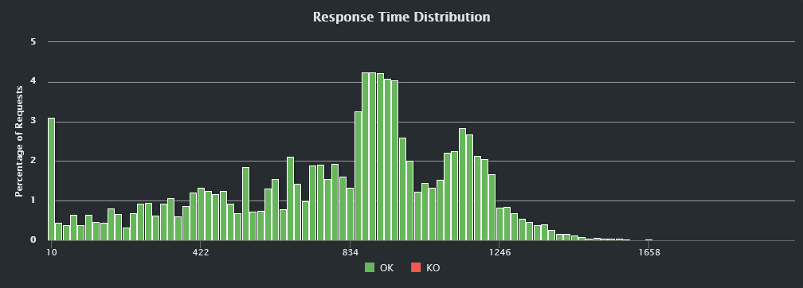

# Order Matching Engine

A single-instrument limit order book with price-time priority matching, exposed over a REST API with live WebSocket streaming of trades and book depth. Spring Boot 4.1 on Java 26, with executed trades persisted to PostgreSQL.

## What it does

Orders arrive over HTTP. The engine matches each incoming order against the opposite side of the book for as long as a price match exists, generating trades along the way. Whatever quantity is left over rests in the book waiting for a counter-order. Every trade is broadcast to subscribed WebSocket clients in real time and persisted to PostgreSQL by a batched background writer, so request threads never wait on the database.

The matching rules:

* **Price priority.** Buy orders are sorted highest-first and sell orders lowest-first, so the best price on either side is always the first entry.
* **Time priority.** Orders at the same price level sit in a FIFO queue, so the oldest resting order fills first.
* **Execution price.** A trade executes at the *resting* order's price rather than the incoming one, because the resting price was already committed to the book before the incoming order showed up.
* **Sequence numbers.** Each trade is stamped with a monotonic sequence number assigned under the write lock, so the true match order is still recoverable even if WebSocket broadcasts arrive out of order.

The book is guarded by a `ReentrantReadWriteLock`. Depth reads can run concurrently with each other, while submits and cancels take the write lock since they mutate the price-level maps.

## Architecture

```
HTTP  --->  OrderBookController  --->  OrderBookService  --->  OrderBook (engine)
                                            |                      |
                                            +---> trade queue ---> batch writer ---> TradeRepository ---> PostgreSQL
                                            |
                                            +---> SimpMessagingTemplate ---> /topic/trades
                                                                             /topic/book
```

| Layer | Responsibility |
| --- | --- |
| `controller/` | HTTP mapping, status codes, request records. Never constructs a domain `Order` itself. |
| `service/OrderBookService` | Owns the single shared `OrderBook` bean, builds validated orders, broadcasts trades, queues them for batched persistence (`saveAll` every 10 ms) and publishes a throttled top-10 depth feed. |
| `engine/OrderBook` | Pure matching logic over a `TreeMap<BigDecimal, Level>` per side, where each `Level` is a FIFO `Deque<Order>` plus a running total quantity. A `UUID -> Order` index makes cancel lookups O(1). No Spring dependencies. |
| `model/` | `Order`, `Trade`, `OrderSide`. Validation lives in the constructors. |
| `repository/` | JPA `TradeEntity` and `TradeRepository`. |

Prices are `BigDecimal` throughout. There is no floating point anywhere in the matching path.

## API

| Method | Endpoint | Description |
| --- | --- | --- |
| `POST` | `/api/orders` | Place an order. Returns `201` with the assigned order id and any resulting trades. |
| `DELETE` | `/api/orders/{id}` | Cancel a resting order. `200` with the cancelled order, or `404`. |
| `GET` | `/api/orders/book` | Current book depth, aggregated quantity per price level, both sides. |
| `GET` | `/api/trades` | All persisted trades. |

Invalid input (null side, non-positive price or quantity) is rejected with a `400` and a structured error body via `@ControllerAdvice`.

Placing an order:

```bash
curl -X POST http://localhost:8080/api/orders \
  -H "Content-Type: application/json" \
  -d '{"side":"BUY","price":100.50,"quantity":25}'
```

```json
{
  "orderId": "3f2a...",
  "trades": [
    { "buyOrderID": "3f2a...", "sellOrderID": "9c11...",
      "price": 100.00, "quantity": 25, "timestamp": "...", "sequenceNum": 1 }
  ]
}
```

### WebSocket (STOMP)

Connect to `ws://localhost:8080/ws` and subscribe to:

* `/topic/trades` for every trade execution as it happens
* `/topic/book` for the top 10 price levels per side, published at most every 50 ms when the book has changed (`GET /api/orders/book` still returns full depth)

## Running it

You'll need Java 26 and Docker for the database.

```bash
docker compose up -d postgres # PostgreSQL 16 on :5432
./mvnw spring-boot:run        # app on :8080
```

The schema is created automatically via `ddl-auto=update`. Actuator is on the classpath for health and metrics.

Once it's up, open [http://localhost:8080](http://localhost:8080) for a live dashboard: book depth, the trade tape, a form to place and cancel orders, and a reference for every REST route and WebSocket topic, all updating in real time off the same `/topic/book` and `/topic/trades` broadcasts described below.

```bash
./mvnw test
```

Unit tests cover the engine's matching paths, the model constructors' validation, the controller layer, the repository, and the WebSocket config.

## Load testing

Load is generated with [Gatling](https://gatling.io). The simulation lives in [`OrderSubmissionSimulation.java`](src/test/java/com/nicholasp/ordermatchingengine/gatling/OrderSubmissionSimulation.java). Each virtual user fires 50 `POST /api/orders` requests back to back with a randomized side, price (95 to 105) and quantity (1 to 20). Every response has to come back `201` or Gatling counts it as a failure.

```bash
./mvnw gatling:test
```

### Results

Both runs use the same 100,000-request heavy scenario (2,000 users ramped over 20 s, 50 orders each) against the packaged jar, with Postgres in Docker, on the same machine. **Before** is the original code. **After** is the version with the fixes described below.

| Run | Requests | Failures | Throughput | p50 | p95 | p99 | Max |
| --- | --- | --- | --- | --- | --- | --- | --- |
| Before | 100,000 | 0 | 2,326 req/s | 518 ms | 848 ms | 1,010 ms | 2,495 ms |
| **After** | 100,000 | 0 | **5,000 req/s** | **<1 ms** | **3 ms** | **87 ms** | 1,218 ms |

The after run reaches the scenario's full offered rate (100,000 requests in 20 s), so the server is no longer the limiting factor at this load. p99 dropped about 11.6x.

### Finding the bottleneck

An earlier version of this README called the app CPU-bound. Profiling showed that was wrong. A Java Flight Recorder (JFR) recording of the before run showed:

* **97% of thread waits (44,215 of 45,596) were request threads blocked in `HikariPool.getConnection()`.** Every trade did a synchronous `tradeRepository.save()` on the request thread, so up to 200 Tomcat threads queued for Hikari's 10 connections.
* **`spring.jpa.show-sql=true` was the top lock-contention site.** Printing every INSERT to the console serialized threads on `PrintStream`.
* **`getBookDepth()` was the #1 CPU method (16% of samples).** It walked every resting order to build a full-book snapshot, then broadcast that snapshot after every order and cancel.

### What changed

1. **Batched, asynchronous trade persistence.** Trades go on an in-memory queue. A scheduled writer drains it every 10 ms and saves batches of up to 500 with `saveAll`, using Hibernate JDBC batching and the Postgres driver's `reWriteBatchedInserts`. The queue is flushed on shutdown. Trade-off: a trade is acknowledged before it's durable, at most one flush interval behind.
2. **SQL console logging off** (`show-sql=false`).
3. **Incremental depth.** Each price level keeps a running total quantity, updated on add, fill and cancel, so depth costs O(levels) instead of O(orders). The WebSocket feed publishes only the top 10 levels per side, at most every 50 ms.
4. **O(1) cancel lookup.** A `UUID -> Order` index replaces the linear scan of both sides under the write lock.

### Core engine microbenchmarks (JMH)

[`OrderBookBenchmark`](src/test/java/com/nicholasp/ordermatchingengine/bench/OrderBookBenchmark.java) measures `OrderBook` on its own: no HTTP, Spring or database, single thread, with orders pre-built so object construction isn't timed.

| Benchmark | Before | After |
| --- | --- | --- |
| `submitOrder` (Gatling-like mix, mostly crossing) | 8.7M orders/s, p99 0.4 µs | 5.7M orders/s, p99 0.7 µs |
| Cancel + re-rest on a 10,000-order book | 57K ops/s, p99 106 µs | **3.0M ops/s, p99 0.8 µs** |

Cancel is about 53x faster in throughput and about 130x faster at p99. Submit is a little slower because each resting order is now also kept in the cancel index. That's a deliberate trade for constant-time cancels.

```bash
./mvnw test-compile
./mvnw exec:exec -Dexec.executable=java -Dexec.classpathScope=test   "-Dexec.args=-cp %classpath org.openjdk.jmh.Main OrderBookBenchmark"
```

### Caveats

* The load generator and the app ran on the same machine and shared CPU cores, so the absolute numbers are pessimistic. A rigorous benchmark would put Gatling on a separate host.
* The Gatling scenario sends no cancels, so the cancel improvement shows up only in JMH.
* The before run was recorded with JFR enabled and the after run without it. JFR's overhead is roughly 1–2%.

<details>
<summary>Original pre-optimization runs (Aug 2026)</summary>

| Run | Users / Ramp | Requests | Failures | Throughput | p50 | p95 | p99 | Max |
| --- | --- | --- | --- | --- | --- | --- | --- | --- |
| Light | 200 / 30s | 10,000 | 0 | 333 req/s | 1 ms | 10 ms | 14 ms | 196 ms |
| Heavy | 2,000 / 20s | 100,000 | 0 | 1,667 req/s | 874 ms | 1,246 ms | 1,394 ms | 2,060 ms |





</details>

## Known limitations

* Single instrument. The book has no symbol dimension.
* Limit orders only. No market, IOC, or FOK order types.
* The book lives in memory. Trades survive a restart, resting orders don't.
* Removing a cancelled order from its price level is O(orders at that price), because levels are `ArrayDeque`s. An intrusive linked list would make the removal O(1) as well.
* Trade persistence is asynchronous, so a crash can lose up to one flush interval (~10 ms) of acknowledged trades. A failed batch write is re-queued and retried on the next flush, but there's no backoff or queue bound yet, so a long database outage grows the queue in memory.
